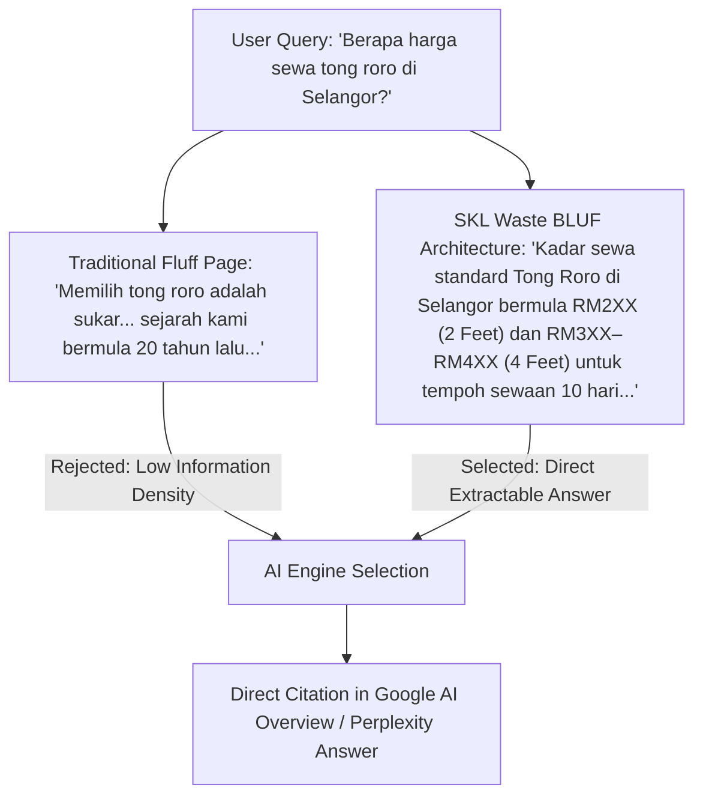
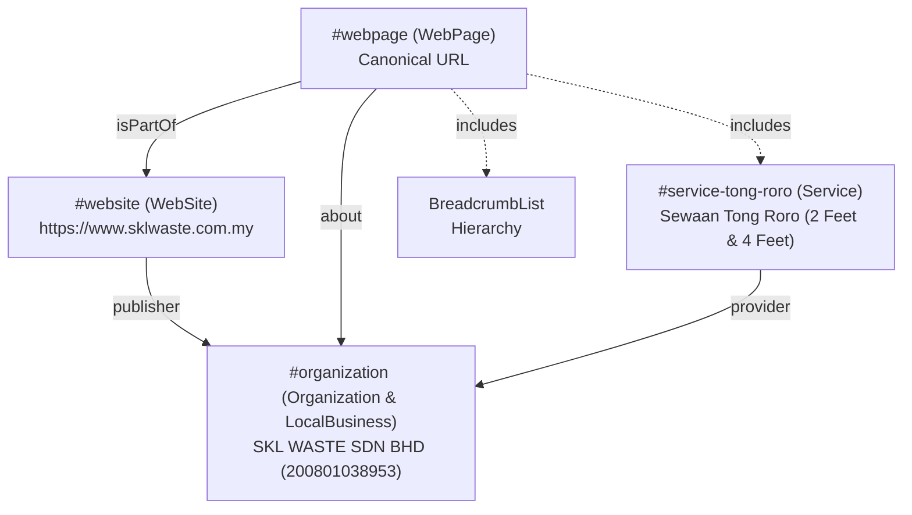

# SKL Waste Sdn Bhd — Generative Engine & Answer Engine Optimization (GEO/AEO) Report

> **Entity:** SKL WASTE SDN BHD (SSM Registration No: 200801038953)  
> **Headquarters:** PT 31127 SETOR JALAN KUALA SELANGOR, 47000 SUNGAI BULOH, SELANGOR DARUL EHSAN  
> **Scope:** Optimization for AI Overviews, Perplexity AI, ChatGPT Search, Claude, Google Gemini, and Traditional Answer Engine Featured Snippets.  
> **Document Status:** Technical Evaluation based on codebase implementation (`src/data/seo.ts`, `src/utils/schema.ts`, `public/llms.txt`, `public/robots.txt`).

---

## 1. Introduction: From Keywords to Entity Retrieval

In modern search ecosystems, discovery has fragmented into two converging paradigms:
1. **Traditional Answer Engine Optimization (AEO)**: Securing Position Zero, Featured Snippets, and Knowledge Panels in Google and Bing.
2. **Generative Engine Optimization (GEO)**: Ensuring that Large Language Models (LLMs) and retrieval-augmented generation (RAG) engines (Google AI Overviews, Perplexity AI, ChatGPT Search, Claude) accurately cite, summarize, and recommend the business.

AI engines do not read web pages like humans; they parse structured data, extract semantically clear passages, and evaluate factual grounding against established knowledge graphs. This report outlines how the SKL Waste digital platform is engineered to dominate generative and answer engine retrieval.

---

## 2. BLUF (Bottom Line Up Front) Direct Answering Architecture

Large language models prioritize direct, concise, information-dense text that immediately answers a user's question without preamble.



### BLUF Implementation Across the SKL Waste Platform
- **Clear Opening Statements**: Every page and section starts with an authoritative summary sentence containing the primary entity, service, location, and key constraint.
  - *Example (`/tong-roro-rental`)*: *"Panduan saiz & kadar sewa Tong Roro 2 Feet (RM2XX) dan 4 Feet (RM3XX–RM4XX) untuk tempoh 10 hari di Selangor."*
- **Direct FAQ Answers**: In the FAQ accordion components, the first sentence immediately resolves the question before providing procedural nuances:
  - *"Berapa lama tempoh sewaan standard? Tempoh sewaan standard bagi semua Tong Roro SKL Waste adalah 10 hari."*
- **Semantic Headings**: H2 and H3 headings are framed as natural user questions or crisp descriptive topics (e.g., `Spesifikasi Saiz Tong Roro: 2 Feet vs 4 Feet`, `Prosedur Tempahan 4 Langkah`), matching user conversational prompts.

---

## 3. Entity Clarity & Schema.org JSON-LD Knowledge Graph

Search and generative engines rely on semantic graphs to disambiguate businesses, avoid entity confusion, and populate Knowledge Panels. The SKL Waste architecture generates a fully connected Schema.org `@graph` on every page via `src/utils/schema.ts`.

### Graph Structure & Node Interconnections



### Verified Graph Attributes
1. **Multi-Typed Entity (`['Organization', 'LocalBusiness']`)**:
   - Legal Name: `SKL WASTE SDN BHD`
   - Identifier: SSM Registration Number `200801038953` formatted as a Schema `PropertyValue`.
   - Complete Headquarters Address: `PT 31127 SETOR JALAN KUALA SELANGOR, 47000 SUNGAI BULOH, SELANGOR DARUL EHSAN, MALAYSIA.`
   - Official Contact Point: `Mr Hari` (`telephone: +60166159365`, `email: tongroroservissklwaste@gmail.com`).
2. **Factual Service Node (`#service-tong-roro`)**:
   - Accurately declares service type as `Waste Container Rental & Disposal`.
   - Incorporates `hasOfferCatalog` listing both products (2 Feet & 4 Feet) and the 9 secondary waste streams without injecting fake numeric transaction prices that could mislead price bots.
3. **BreadcrumbList**:
   - Provides explicit position-indexed URL hierarchies for clean snippet breadcrumb rendering.

---

## 4. Evaluation of `/llms.txt`

The platform ships an optimized `/llms.txt` file at `public/llms.txt`.

### What `/llms.txt` Provides
- Standardized markdown format designed specifically for automated consumption by AI agents, RAG pipelines, and conversational models.
- Fast, clean summary of corporate credentials (SSM `200801038953`), operational phone line (`+60 16-615 9365`), bin specifications (2ft low-wall vs 4ft high-wall), standard 10-day duration, 13 service areas, and 10 industries served.
- Stripped of all presentation layout, CSS, and navigation markup, allowing LLM scrapers to absorb the complete business reality in under 1,500 tokens.

### Critical Distinction: Informational Retrieval vs Google Ranking Factor

> [!IMPORTANT]
> **Technical Reality Check:**
> `/llms.txt` is an emerging community standard designed to assist AI models (such as Cursor, Perplexity, ChatGPT, and custom LLM scrapers) in understanding site structure and business facts.
>
> **`/llms.txt` is NOT an official Google Search ranking factor.** Googlebot and Google's core search ranking algorithms rely on HTML content, HTTP headers, XML sitemaps, and Schema.org structured data. Having `/llms.txt` does not directly increase organic SERP rankings on Google, but it significantly improves accuracy and citation frequency when AI agents answer queries about the company.

---

## 5. AI Crawler Permissions in `robots.txt`

The site's `public/robots.txt` is deliberately configured for universal accessibility:

```text
User-agent: *
Allow: /

# Ensure search engine crawlers have access to static styling, images, and scripts
Allow: /_astro/
Allow: /images/

# XML Sitemap
Sitemap: https://www.sklwaste.com.my/sitemap.xml
```

### Crawl Policy for Generative Agents
- **Unrestricted Public Access**: By using `User-agent: * Allow: /`, all reputable AI search crawlers—including `GPTBot` (OpenAI), `PerplexityBot`, `ClaudeBot` (Anthropic), `Google-Extended` (Gemini), and `Applebot-Extended`—have full permission to crawl and index public pages.
- **Resource Completeness**: Explicitly allows `/_astro/` and `/images/` so AI visual rendering agents can verify visual layout, typography, and authentic photography.
- **Zero Rate Limiting Blocks**: Static HTML served over CDN allows high-frequency AI scraping without triggering rate limits or 429 errors.

---

## 6. Ethical Grounding & Avoiding Deprecated Practices

### Strict Grounding in Business Facts
Generative engines penalize sites that exhibit hallucinations, contradictory claims, or unverified claims. The platform enforces 100% adherence to verified facts:
- **No Fabricated Testimonials**: Zero fake reviews, star ratings, or customer avatars.
- **No Invented Client Logos**: Zero fabricated partnerships in `/industries-we-serve`.
- **Provisional Pricing Disclaimers**: Explicitly states `RM2XX` and `RM3XX–RM4XX` as provisional estimates, preventing AI bots from committing to unconfirmed contract rates.
- **Rental Duration Accuracy**: 100% consistent `10 days` standard duration across all pages, completely eliminating deprecated 7-day mentions.

### Why `FAQPage` Rich-Result Chasing Was Avoided

In past years, webmasters routinely marked up all FAQ accordions with `FAQPage` Schema.org markup to trigger expandable accordion snippets in Google search results.

**Why `FAQPage` Schema is intentionally omitted here:**
1. **Google August 2023 Search Update**: Google officially deprecated `FAQPage` rich results for general commercial websites, restricting their display almost exclusively to authoritative government and healthcare organizations (`.gov` and `.edu`).
2. **Spam & Penalty Mitigation**: Attempting to force `FAQPage` markup on commercial product pages now provides zero SERP appearance benefit and risks manual action for deceptive structured data markup.
3. **Superior Semantic Approach**: Instead of outdated schema tricks, the platform uses semantic HTML5 `<details>` and `<summary>` elements with clean text. This provides accessible, interactive UX for human visitors while allowing AI crawlers to parse questions and answers natively from the DOM.
