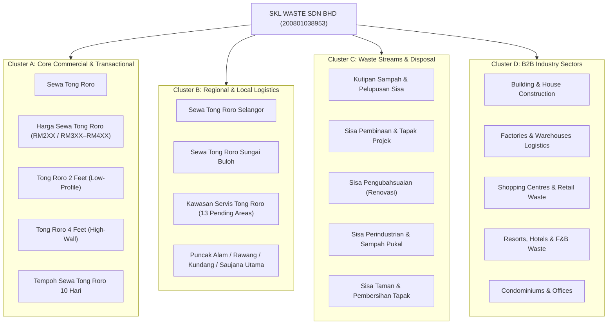
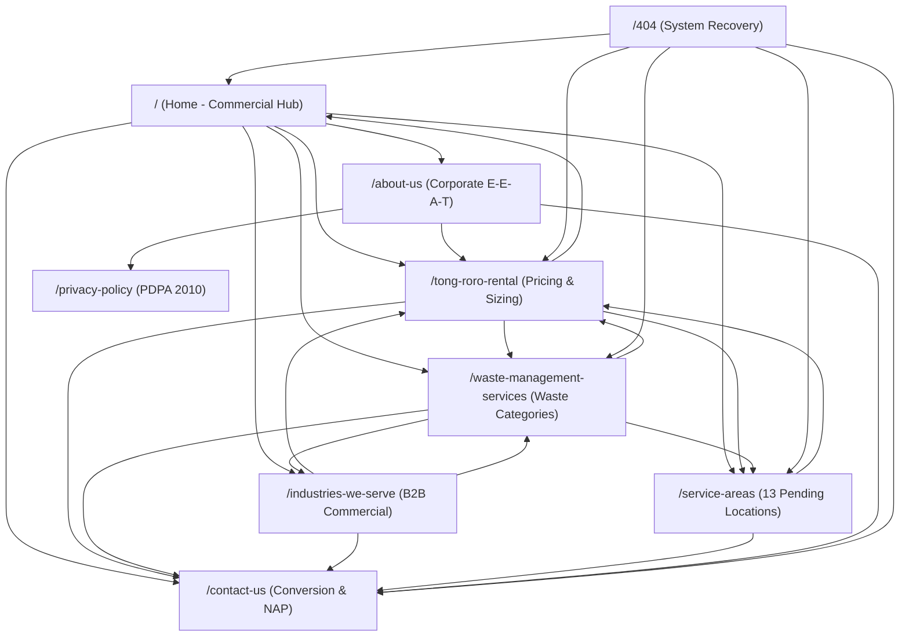

# SKL Waste Sdn Bhd — Keyword Map & Search Strategy

> **Entity:** SKL WASTE SDN BHD (SSM Registration No: 200801038953)  
> **Headquarters:** PT 31127 SETOR JALAN KUALA SELANGOR, 47000 SUNGAI BULOH, SELANGOR DARUL EHSAN  
> **Primary Service:** Sewaan Tong Roro (Roll-On Roll-Off Bin Rental) & Waste Management  
> **Official Domain:** `https://www.sklwaste.com.my`  
> **Contact Dispatch:** Mr Hari (`+60 16-615 9365` / `tongroroservissklwaste@gmail.com`)  
> **Document Status:** Grounded in codebase verification (`src/data/seo.ts`, `src/data/products.ts`, `src/data/services.ts`, `src/data/serviceAreas.ts`, `src/data/industries.ts`).

---

## 1. Transparency & Methodology Notice

> [!NOTE]
> **Data Integrity Disclosure:**
> Live search volumes (MSV) and Keyword Difficulty (KD%) metrics require active subscriptions to third-party crawling indexes such as Google Keyword Planner, Ahrefs, or Semrush. In strict compliance with project truthfulness rules, **no fabricated or simulated numerical search volumes or keyword difficulties are presented in this document**.
>
> Keywords mapped below represent verified customer search intent patterns, high-relevance bilingual queries (Bahasa Malaysia & English), regional logistics demand in Selangor/Klang Valley, and exact product/service taxonomies from the verified business records of SKL Waste Sdn Bhd.

---

## 2. Strategic Keyword Clusters

### Cluster Summary Table

| Cluster | Primary Intent | Core Query Themes | Primary Target Landing Pages |
| :--- | :--- | :--- | :--- |
| **Cluster A: Core Commercial & Transactional** | Commercial Investigation & Transactional | `Sewa Tong Roro`, `Tong Roro 2 Feet`, `Tong Roro 4 Feet`, `Harga Sewa Tong Roro`, `Tempoh Sewa 10 Hari` | `/`, `/tong-roro-rental` |
| **Cluster B: Regional & Local Intent** | Local Commercial & Navigational | `Sewa Tong Roro Selangor`, `Sewa Tong Roro Sungai Buloh`, `Puncak Alam`, `Rawang`, `Kundang` | `/service-areas`, `/`, `/contact-us` |
| **Cluster C: Waste Categories & Disposal** | Informational & Commercial Problem Solving | `Kutipan sampah`, `Pelupusan sisa`, `Sisa pembinaan`, `Sisa renovasi`, `Sampah pukal` | `/waste-management-services` |
| **Cluster D: Industry & Commercial B2B** | Commercial Investigation | `Tong Roro kilang`, `Tong Roro tapak pembinaan`, `Pengurusan sisa hotel/pusat membeli-belah` | `/industries-we-serve` |

---

## 3. Comprehensive URL-to-Keyword Strategy Map (9 Pages)

### Page 1: Homepage (`/`)
- **Canonical URL:** `https://www.sklwaste.com.my`
- **Search Intent:** Commercial Investigation / Transactional
- **Page Title:** `Sewa Tong Roro Selangor & Sungai Buloh | SKL Waste` (54 characters)
- **Meta Description:** `Sewa Tong Roro 2ft & 4ft di Selangor & Sungai Buloh dengan SKL Waste Sdn Bhd. Tempoh 10 hari, harga telus bermula RM2XX. Hubungi Mr Hari +60 16-615 9365.` (154 characters)
- **H1 Heading:** `SEWA TONG RORO. PENGURUSAN SISA LEBIH MUDAH.`
- **Primary Keyword:** `Sewa Tong Roro Selangor & Sungai Buloh`
- **Secondary Keywords:**
  - `Servis Tong Roro`
  - `Harga Sewa Tong Roro`
  - `Pengurusan Sisa Selangor`
  - `Tong Roro 10 Hari`
- **Content Focus:** Executive brand presentation, hero bin showcase, 2ft/4ft product overview, 4-step rental process, Sungai Buloh logistics presence, verified NAP, and embedded quotation form.
- **Internal Linking Map:**
  - *Outbound Links:* `/tong-roro-rental`, `/waste-management-services`, `/industries-we-serve`, `/service-areas`, `/about-us`, `/contact-us`, `/#quotation-form`
  - *Inbound Links:* Sitewide logo in Header & Footer, breadcrumb roots, 404 navigation cards.
- **Conversion Objective:** Submission of initial quotation form (`#quotation-form`) or direct phone dispatch to Mr Hari (`tel:+60166159365`).

---

### Page 2: Tong Roro Rental Catalog (`/tong-roro-rental`)
- **Canonical URL:** `https://www.sklwaste.com.my/tong-roro-rental`
- **Search Intent:** Transactional / Commercial
- **Page Title:** `Harga Sewa Tong Roro 2 Feet & 4 Feet | SKL Waste` (51 characters)
- **Meta Description:** `Panduan saiz & kadar sewa Tong Roro 2 Feet (RM2XX) dan 4 Feet (RM3XX–RM4XX) untuk tempoh 10 hari di Selangor. Minta sebut harga rasmi dari Mr Hari hari ini.` (156 characters)
- **H1 Heading:** `Katalog & Kadar Sewaan Tong Roro`
- **Primary Keyword:** `Harga Sewa Tong Roro 2 Feet & 4 Feet`
- **Secondary Keywords:**
  - `Tong Roro 2 Feet`
  - `Tong Roro 4 Feet`
  - `Tempoh Sewa Tong Roro 10 Hari`
  - `Cara Memilih Saiz Tong Roro`
  - `Kadar Sewa Tong Roro RM2XX`
- **Content Focus:** Detailed dimensional profiles (2ft low-wall for heavy construction debris vs 4ft high-wall for bulky waste), pricing table (`RM2XX` and `RM3XX–RM4XX`), 10-day standard rental duration, unconfirmed delivery charges disclosure, waste type suitability guide, and embedded quotation form.
- **Internal Linking Map:**
  - *Outbound Links:* `/#quotation-form`, `/waste-management-services`, `/service-areas`, `/contact-us`, `tel:+60166159365`
  - *Inbound Links:* Homepage product cards, Header/Footer navigation, ServiceList cards, 404 quick links.
- **Conversion Objective:** Product size selection (2 Feet or 4 Feet) and completed quotation enquiry with required delivery date.

---

### Page 3: Waste Management Services (`/waste-management-services`)
- **Canonical URL:** `https://www.sklwaste.com.my/waste-management-services`
- **Search Intent:** Informational / Commercial Investigation
- **Page Title:** `Perkhidmatan Pengurusan & Pelupusan Sisa | SKL Waste` (54 characters)
- **Meta Description:** `Perkhidmatan kutipan, pengangkutan dan pelupusan sisa pembinaan, perindustrian, pengubahsuaian serta sampah pukal di Selangor oleh SKL Waste Sdn Bhd.` (147 characters)
- **H1 Heading:** `Perkhidmatan Pengurusan Sisa`
- **Primary Keyword:** `Perkhidmatan Pengurusan & Pelupusan Sisa`
- **Secondary Keywords:**
  - `Kutipan Sampah Selangor`
  - `Pelupusan Sisa Berjadual / Am`
  - `Pengangkutan Sampah Lori Roro`
  - `Sisa Pembinaan & Pengubahsuaian`
  - `Sisa Perindustrian & Sampah Pukal`
  - `Sisa Taman & Pembersihan Tapak`
- **Content Focus:** Core service spotlight (`Sewaan Tong Roro`) plus the exact 9 secondary waste categories with English explanations, prohibited waste disclosures (scheduled/hazardous wastes barred under EQA 1974), and service availability verification guidance.
- **Internal Linking Map:**
  - *Outbound Links:* `/tong-roro-rental#tong-roro-2-feet`, `/tong-roro-rental#tong-roro-4-feet`, `/industries-we-serve`, `/service-areas`, `/#quotation-form`
  - *Inbound Links:* Header/Footer navigation, Homepage service summary, IndustryGrid cross-links, 404 page.
- **Conversion Objective:** Route waste disposal inquiries to quotation submission specifying waste stream types.

---

### Page 4: Industries We Serve (`/industries-we-serve`)
- **Canonical URL:** `https://www.sklwaste.com.my/industries-we-serve`
- **Search Intent:** Commercial Investigation (B2B)
- **Page Title:** `Pengurusan Sisa Komersial, Pembinaan & Industri | SKL Waste` (59 characters)
- **Meta Description:** `Penyelesaian Tong Roro untuk tapak pembinaan, perumahan, kilang, hotel, restoran dan komersial di Selangor. Dapatkan rundingan sebut harga bersama Mr Hari.` (154 characters)
- **H1 Heading:** `Industri Yang Kami Layan`
- **Primary Keyword:** `Pengurusan Sisa Komersial, Pembinaan & Industri`
- **Secondary Keywords:**
  - `Tong Roro Tapak Pembinaan`
  - `Tong Roro Renovasi Rumah`
  - `Pengurusan Sisa Kilang & Gudang`
  - `Sewa Tong Roro Hotel & Restoran`
  - `Tong Roro Kondominium & Pejabat`
- **Content Focus:** 10 verified commercial/industrial sectors (`Resorts and hotels`, `Factories and warehouses`, `Colleges and universities`, `Shopping centres`, `Building construction`, `House construction`, `Hospitals`, `Offices`, `Food and beverage industries`, `Condominiums and apartments`). Includes sector-by-sector waste profiling, sizing recommendations, and an explicit disclaimer that zero past client relationships are fabricated.
- **Internal Linking Map:**
  - *Outbound Links:* `/tong-roro-rental#quotation-form`, `/waste-management-services`, `/contact-us`, `tel:+60166159365`
  - *Inbound Links:* Header/Footer navigation, Homepage industry highlights, ServiceList cross-links.
- **Conversion Objective:** B2B commercial quotation request via web form or direct consultation with Mr Hari.

---

### Page 5: Service Areas (`/service-areas`)
- **Canonical URL:** `https://www.sklwaste.com.my/service-areas`
- **Search Intent:** Navigational / Local Commercial
- **Page Title:** `Kawasan Servis Tong Roro Sungai Buloh & Selangor | SKL` (54 characters)
- **Meta Description:** `Kawasan liputan servis Tong Roro Sungai Buloh, Puncak Alam, Rawang, Kundang & Saujana Utama. Semua kawasan tertakluk pengesahan ketersediaan dengan Mr Hari.` (158 characters)
- **H1 Heading:** `Kawasan Perkhidmatan`
- **Primary Keyword:** `Kawasan Servis Tong Roro Sungai Buloh & Selangor`
- **Secondary Keywords:**
  - `Sewa Tong Roro Sungai Buloh`
  - `Sewa Tong Roro Puncak Alam`
  - `Sewa Tong Roro Rawang`
  - `Sewa Tong Roro Kundang`
  - `Sewa Tong Roro Saujana Utama`
  - `Sewa Tong Roro Bukit Jelutong`
- **Content Focus:** Single authoritative local directory covering all 13 listed locations (`Desa Coalfields`, `Bandar Seri Coalfields`, `Sungai Buloh`, `Paya Jaras`, `Bukit Jelutong`, `Bukit Beruntung`, `Kundang`, `Puncak Alam`, `Aman Putri`, `Tasik Puteri`, `Saujana Utama`, `Subang`, `Rawang`). Each item is explicitly tagged `Pending Verification` with clear instructions on verifying driver schedule and delivery charges with Mr Hari.
- **Internal Linking Map:**
  - *Outbound Links:* `/contact-us#quotation-form`, `/tong-roro-rental`, `tel:+60166159365`
  - *Inbound Links:* Header/Footer navigation, Homepage local summary, ServiceList cross-links.
- **Conversion Objective:** Direct phone call to Mr Hari (`tel:+60166159365`) to verify delivery location and route feasibility.

---

### Page 6: About Us (`/about-us`)
- **Canonical URL:** `https://www.sklwaste.com.my/about-us`
- **Search Intent:** Informational / Navigational
- **Page Title:** `SKL Waste Sdn Bhd (200801038953) Sungai Buloh | Profil` (54 characters)
- **Meta Description:** `Mengenai SKL Waste Sdn Bhd (200801038953). Syarikat berdaftar pengurusan sisa dan sewaan Tong Roro beribu pejabat di Sungai Buloh, Selangor Darul Ehsan.` (151 characters)
- **H1 Heading:** `Mengenai SKL Waste Sdn Bhd`
- **Primary Keyword:** `SKL Waste Sdn Bhd (200801038953) Sungai Buloh`
- **Secondary Keywords:**
  - `Syarikat Sewa Tong Roro Berdaftar Selangor`
  - `Ibu Pejabat Sungai Buloh PT 31127`
  - `Profil Syarikat SKL Waste`
  - `Pengurusan Sisa Berlesen Selangor`
- **Content Focus:** Corporate identity, official SSM registration number (`200801038953`), registered depot address at Sungai Buloh, logistics capability, environmental waste compliance standards, and transparent operational policies.
- **Internal Linking Map:**
  - *Outbound Links:* `/tong-roro-rental`, `/waste-management-services`, `/contact-us`, `/privacy-policy`
  - *Inbound Links:* Header/Footer navigation, Footer corporate credentials, Privacy Policy references.
- **Conversion Objective:** Establish corporate E-E-A-T and regulatory confidence, directing commercial procurement managers to contact Mr Hari.

---

### Page 7: Contact Us (`/contact-us`)
- **Canonical URL:** `https://www.sklwaste.com.my/contact-us`
- **Search Intent:** Transactional / Navigational
- **Page Title:** `Hubungi SKL Waste Sdn Bhd & Sebut Harga Mr Hari` (47 characters)
- **Meta Description:** `Hubungi Mr Hari di +60 16-615 9365 atau emel tongroroservissklwaste@gmail.com untuk sebut harga segera Tong Roro dan perkhidmatan sisa di Sungai Buloh.` (151 characters)
- **H1 Heading:** `Hubungi Kami & Dapatkan Sebut Harga`
- **Primary Keyword:** `Hubungi SKL Waste Sdn Bhd & Sebut Harga Mr Hari`
- **Secondary Keywords:**
  - `Sebut Harga Tong Roro`
  - `Telefon Mr Hari +60 16-615 9365`
  - `Emel SKL Waste Sungai Buloh`
  - `Tempahan Tong Roro Selangor`
- **Content Focus:** Complete verified NAP, click-to-call telephone dispatch (`tel:+60166159365`), click-to-email dispatch (`mailto:tongroroservissklwaste@gmail.com`), operating hours (Mon–Sat 8:00 AM – 6:00 PM), pending WhatsApp status verification banner, interactive quotation form, and general inquiry form.
- **Internal Linking Map:**
  - *Outbound Links:* `/`, `/tong-roro-rental`, `/service-areas`, `/privacy-policy`
  - *Inbound Links:* Header CTA button, Mobile sticky call bar, Footer contact column, sitewide CTAs.
- **Conversion Objective:** Direct phone dispatch or form inquiry submission with explicit rental requirements.

---

### Page 8: Privacy Policy (`/privacy-policy`)
- **Canonical URL:** `https://www.sklwaste.com.my/privacy-policy`
- **Search Intent:** Legal / Compliance
- **Page Title:** `Dasar Privasi SKL Waste Sdn Bhd (PDPA 2010)` (44 characters)
- **Meta Description:** `Dasar Privasi SKL Waste Sdn Bhd (200801038953). Ketahui pengendalian data peribadi pertanyaan sebut harga mengikut Akta Perlindungan Data Peribadi 2010.` (153 characters)
- **H1 Heading:** `Dasar Privasi`
- **Primary Keyword:** `Dasar Privasi SKL Waste Sdn Bhd (PDPA 2010)`
- **Secondary Keywords:**
  - `Akta Perlindungan Data Peribadi 2010`
  - `PDPA SKL Waste`
  - `Pengendalian Data Borang Sebut Harga`
- **Content Focus:** Compliance with Malaysian Personal Data Protection Act 2010 (PDPA 2010), enumeration of all 7 quotation enquiry fields, operational purpose limitation (strictly quotation preparation and delivery coordination with Mr Hari), no third-party database disclosure, and data subject access/correction rights.
- **Internal Linking Map:**
  - *Outbound Links:* `/contact-us`, `/tong-roro-rental`, `/about-us`
  - *Inbound Links:* Sitewide Footer legal column, Form disclaimers.
- **Conversion Objective:** Regulatory legal compliance and user data protection reassurance.

---

### Page 9: Custom 404 Error Page (`/404`)
- **Canonical URL:** `https://www.sklwaste.com.my/404` (Enforces `noindex, follow`)
- **Search Intent:** System / Navigational Recovery
- **Page Title:** `404 Halaman Tidak Dijumpai | SKL Waste Sdn Bhd` (48 characters)
- **Meta Description:** `Halaman yang dicari tidak dijumpai. Sila kembali ke laman utama atau hubungi Mr Hari di +60 16-615 9365 untuk bantuan sewaan Tong Roro.` (136 characters)
- **H1 Heading:** `404 - Halaman Tidak Dijumpai`
- **Primary Keyword:** `Halaman Tidak Dijumpai SKL Waste`
- **Content Focus:** Clean executive layout, clear error explanation, links to top 5 destination routes, direct contact links to Mr Hari (`tel:+60166159365`), and `noindex` tag to prevent search engine indexing of invalid URLs.
- **Internal Linking Map:**
  - *Outbound Links:* `/`, `/tong-roro-rental`, `/waste-management-services`, `/service-areas`, `/contact-us`, `tel:+60166159365`
- **Conversion Objective:** Traffic salvage and recovery back to transactional paths or phone dispatch.

---

## 4. Internal Linking Architecture Diagram

