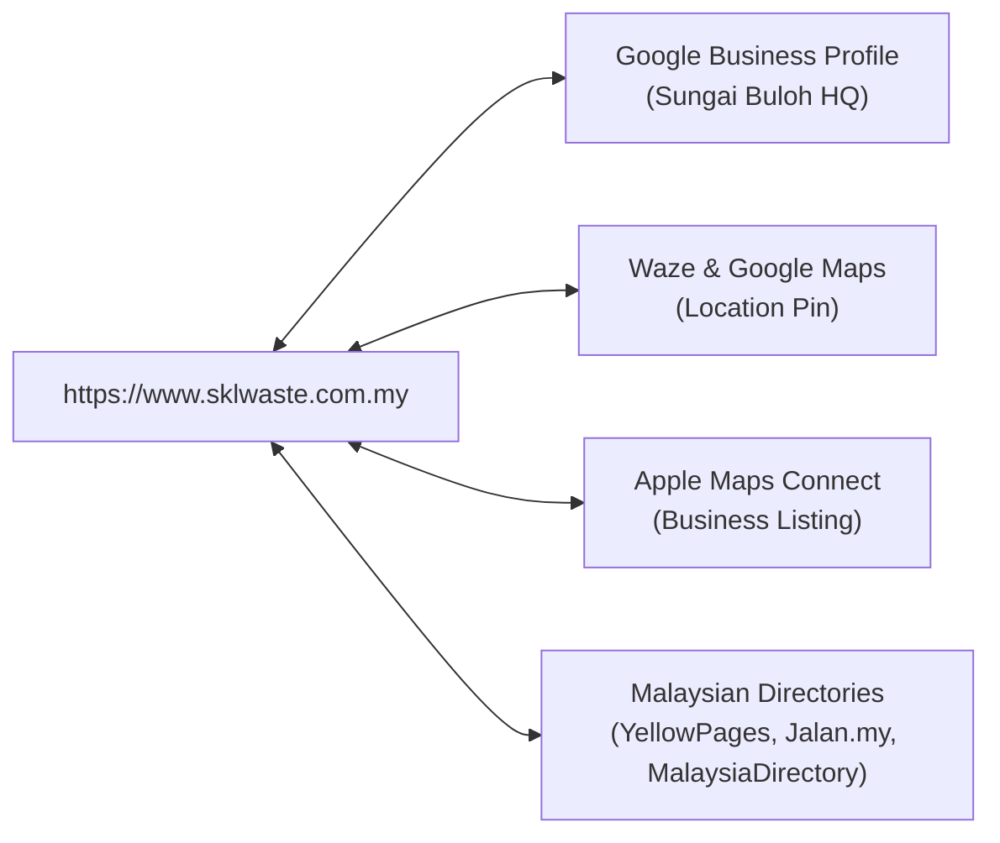

# SKL Waste Sdn Bhd — Local SEO & Google Business Profile (GBP) Plan

> **Entity:** SKL WASTE SDN BHD (SSM Registration No: 200801038953)  
> **Physical Headquarters:** PT 31127 SETOR JALAN KUALA SELANGOR, 47000 SUNGAI BULOH, SELANGOR DARUL EHSAN, MALAYSIA.  
> **Operational Dispatcher:** Mr Hari (`+60 16-615 9365` / `tongroroservissklwaste@gmail.com`)  
> **Official Website:** `https://www.sklwaste.com.my`  
> **Target Geographic Market:** Sungai Buloh, Petaling, Gombak, Kuala Selangor, and Greater Selangor.

---

## 1. Executive Summary & Local Strategy Overview

Local Search Engine Optimization for SKL Waste Sdn Bhd is engineered around high-trust physical proximity to the Sungai Buloh logistics corridor (Jalan Kuala Selangor / Federal Route 54). Roll-On Roll-Off (Tong Roro) waste hauling is an operationally intensive, hyper-local service where dispatch turnaround, road clearance, and distance from the vehicle depot govern operational viability.

The local SEO strategy focuses on:
1. **Uncompromising NAP Consistency**: Total uniformity of Name, Address, and Phone across the web, Schema.org JSON-LD, and business directories.
2. **Conservative Service Area Architecture**: Consolidating local signals onto a single authoritative `/service-areas` page while strictly avoiding thin programmatic "doorway pages" that violate Google spam guidelines.
3. **Google Business Profile (GBP) Verification**: Securing the primary physical pin at Sungai Buloh with authentic photos and clear operating hours.
4. **Privacy-Safe Conversion Tracking**: Tracking telephone and quotation conversion actions while strictly protecting user PII in compliance with the Malaysian Personal Data Protection Act 2010 (PDPA).

---

## 2. Canonical Business Information (NAP Core)

Every local directory listing, citation, and on-page element must reproduce this exact information verbatim:

```text
Business Name:        SKL WASTE SDN BHD
Registration Number:  200801038953
Street Address:       PT 31127 SETOR JALAN KUALA SELANGOR
Postcode:             47000
City:                 SUNGAI BULOH
State:                SELANGOR DARUL EHSAN
Country:              MALAYSIA
Full Address:         PT 31127 SETOR JALAN KUALA SELANGOR, 47000 SUNGAI BULOH, SELANGOR DARUL EHSAN, MALAYSIA.
Key Contact Person:   Mr Hari
Telephone (Display):  +60 16-615 9365
Telephone (Link):     tel:+60166159365
Email:                tongroroservissklwaste@gmail.com
Website:              https://www.sklwaste.com.my
Operating Hours:      Isnin – Sabtu: 8:00 AM – 6:00 PM | Ahad: Atas Temujanji / Tertakluk kepada ketersediaan
WhatsApp Status:      Pending Verification (Do NOT publish active wa.me link until confirmed)
```

---

## 3. The 13 Service Areas: Architecture & Anti-Doorway Strategy

### The 13 Candidate Locations
The following 13 locations represent active operational inquiry zones in Selangor:
1. Desa Coalfields
2. Bandar Seri Coalfields
3. Sungai Buloh
4. Paya Jaras
5. Bukit Jelutong
6. Bukit Beruntung
7. Kundang
8. Puncak Alam
9. Aman Putri
10. Tasik Puteri
11. Saujana Utama
12. Subang
13. Rawang

### Why Doorway Pages Were Rejected
A common low-quality SEO tactic is generating dozens of nearly identical pages (e.g. `/sewa-tong-roro-puncak-alam`, `/sewa-tong-roro-rawang`, `/sewa-tong-roro-kundang`) that change only the city name in the H1 tag.

**Why this was strictly avoided for SKL Waste Sdn Bhd:**
1. **Google Search Essentials Spam Policy**: Google's spam policies explicitly penalize programmatic doorway pages that exist solely to capture geographic queries without providing distinct, localized value.
2. **Operational Integrity**: Because delivery and collection surcharges depend on diesel costs and vehicle availability from the Sungai Buloh yard, promising immediate fixed-rate service in unverified towns without dispatch confirmation creates false expectations.
3. **Consolidated Topical Authority**: Hosting all 13 locations on a single high-quality page (`/service-areas`) aggregates all inbound link equity and user engagement, presenting a transparent table of pending verification areas with clear instructions to call Mr Hari (`+60 16-615 9365`) to verify access.

### Transition Roadmap (Phase 2 to Phase 3+)
Once Mr Hari confirms regular delivery schedules and standardized zoning rates for specific townships (e.g., Puncak Alam or Rawang), dedicated location guides may be authored—provided each contains:
- Genuine facility route information (toll routes, truck height restrictions).
- Specific local authority waste disposal rules (e.g., Majlis Perbandaran Selayang vs Majlis Bandaraya Shah Alam).
- Authentic photographs of bins delivered in that specific locality.

---

## 4. Google Business Profile (GBP) Implementation Checklist

Setting up and verifying the Google Business Profile is the highest priority local milestone.

| Checkpoint | Recommended Setting / Value | Status / Action Required |
| :--- | :--- | :--- |
| **Business Name** | `SKL Waste Sdn Bhd` (Do not stuff keywords like "Best Tong Roro") | Ready to submit |
| **Primary Category** | `Waste management service` | Recommended primary |
| **Secondary Categories** | `Dumpster rental service`, `Debris removal service`, `Garbage collection service` | Recommended secondary |
| **Physical Address** | `PT 31127 SETOR JALAN KUALA SELANGOR, 47000 SUNGAI BULOH, SELANGOR` | Ensure physical signboard is visible at the setor gate for video verification |
| **Service Area Settings** | Specify Selangor, Sungai Buloh, Petaling, Gombak, and Kuala Selangor | Set radius around Sungai Buloh depot |
| **Phone Number** | `+60 16-615 9365` | Direct to Mr Hari |
| **Website URL** | `https://www.sklwaste.com.my` | Tracked with clean UTM tags (`?utm_source=gbp&utm_medium=organic`) |
| **Opening Hours** | Monday–Saturday: 08:00 – 18:00; Sunday: Closed / By Appointment | Matches website |
| **Business Description** | Factual description emphasizing SSM Reg `200801038953`, 2ft & 4ft Tong Roro rental, 10-day duration, and transparent service. | Drafted |
| **Media / Photos** | Upload official logo (`/images/skl-logo.png`) and real fleet photo (`/images/skl-hero-roro.jpg`). Add depot gate photo when available. | Phase 2 assets staged |
| **WhatsApp Messaging** | **DISABLE / LEAVE UNCHECKED** | **MANDATORY**: WhatsApp availability is pending verification. Do not enable until Mr Hari confirms. |
| **Verification Method** | Video verification showing street sign `JALAN KUALA SELANGOR`, gate number `PT 31127`, and company vehicle/bins. | Requires on-site manual execution by business owner |

---

## 5. Local Citations & Directory Distribution Plan

To build local domain authority and geographic relevance, citations must be submitted to established Malaysian business directories using the exact canonical NAP:



### High-Priority Malaysian Directories
1. **Yellow Pages Malaysia (`yellowpages.my`)**: Primary corporate citation under Waste Management / Lori Sewa.
2. **Jalan.my / BusinessList.my**: Free Malaysian business registry for local logistics providers.
3. **MalaysiaDirectory.com.my**: Established industrial and corporate directory.
4. **Waze Map Editor / Place Addition**: Add physical pin for `Setor SKL Waste Sdn Bhd` at Jalan Kuala Selangor to facilitate customer drop-offs and truck navigation.
5. **Apple Business Connect**: Claim listing for Apple Maps navigation on iOS devices.

---

## 6. Privacy-Safe Conversion Tracking Setup

In accordance with the Malaysian Personal Data Protection Act (PDPA 2010), local tracking must measure lead generation without storing or transmitting personal identifying information (PII).

### Integrated Event Architecture (`src/utils/analytics.ts`)

```typescript
// Sanitized event tracking: no customerName, phoneNumber, or address is ever logged
export function trackConversionEvent(
  eventName: ConversionEventName,
  metadata?: Record<string, string>
): void;
```

### Conversion Actions & Triggers

| Event Name | User Trigger | Payload Parameters (Non-PII) | Business Value |
| :--- | :--- | :--- | :--- |
| `telephone_click` | Clicking `tel:+60166159365` anywhere on site (Header, Footer, Floating Bar, Contact Cards) | `{ destination: '+60166159365', source_page: '/...' }` | Direct phone dispatch lead |
| `email_click` | Clicking `mailto:tongroroservissklwaste@gmail.com` | `{ destination: 'tongroroservissklwaste@gmail.com' }` | Direct corporate email lead |
| `product_select` | Clicking 2 Feet or 4 Feet product card button | `{ product_id: 'tong-roro-2-feet' }` | Commercial product intent |
| `quotation_form_submit` | Validated submission of quotation form | `{ bin_size: '4 Feet', area_status: 'pending_verification', waste_category: 'Sisa pembinaan' }` | High-intent web quotation inquiry |
| `primary_cta_click` | Clicking "Dapatkan Sebut Harga" in Hero section | `{ cta_label: 'Dapatkan Sebut Harga', target: '/#quotation-form' }` | Engagement funnel velocity |

### Google Tag Manager & GA4 Integration Instructions
When the client provisions Google Tag Manager (`PUBLIC_GTM_ID="GTM-XXXXXXX"`) and GA4 (`PUBLIC_GA4_MEASUREMENT_ID="G-XXXXXXXXXX"`):
1. **Custom Event Triggers in GTM**:
   - Create triggers for custom event names: `telephone_click`, `email_click`, `quotation_form_submit`.
2. **GA4 Event Tag**:
   - Map event parameters (`bin_size`, `waste_category`, `source_page`).
3. **Google Ads Conversion Linker**:
   - Link `quotation_form_submit` and `telephone_click` as primary conversion actions in Google Ads to calculate return on ad spend (ROAS) for local campaigns.
