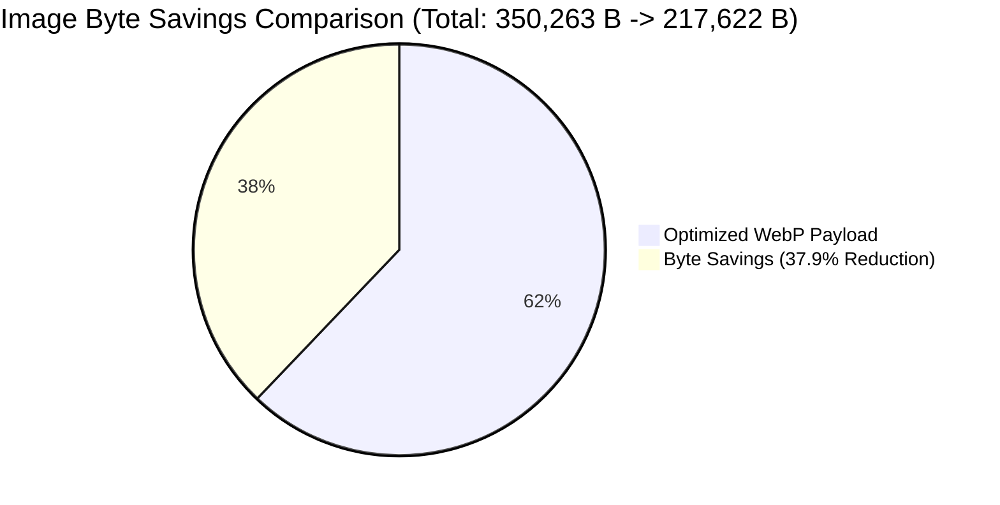

# SKL Waste Sdn Bhd — Technical SEO Implementation & Engineering Log

> **Entity:** SKL WASTE SDN BHD (SSM Registration No: 200801038953)  
> **Headquarters:** PT 31127 SETOR JALAN KUALA SELANGOR, 47000 SUNGAI BULOH, SELANGOR DARUL EHSAN  
> **Framework:** Astro 5 (Static Output Mode) + TypeScript 5.7  
> **Production Domain:** `https://www.sklwaste.com.my`  
> **Document Purpose:** Engineering audit and implementation log for Phase 3 technical SEO, Schema.org knowledge graph, asset compression, and analytics wiring.

---

## 1. Installed Skills & Customization Inventory

The project incorporates specialized engineering skills adhering to modern search engine optimization and agentic coding principles:

| Skill Identifier | Source / Author | Installed Path | License | Primary Purpose & Activation Triggers |
| :--- | :--- | :--- | :--- | :--- |
| **`seo`** (Agentic SEO Suite) | `Bhanunamikaze/Agentic-SEO-Skill` | `.agents/skills/seo/`<br/>`.agent/skills/seo/` | MIT | Complete suite of 16 sub-skills, 10 specialist agents, and 89 Python/Bash audit scripts covering technical SEO, schema validation, sitemap verification, Core Web Vitals, and accessibility. |
| **`seo-geo-aeo-optimizer`** | `arslan-36/antigravity-seo-geo-aeo-skills` | `.agents/skills/seo-geo-aeo-optimizer/` | MIT | Framework for modern Search Engine, Generative Engine, and Answer Engine Optimization (GEO/AEO). Enforces topical clustering, BLUF answer design, and human-written content authenticity. |
| **`ponytail`** | `DietrichGebert/ponytail` | `.agents/skills/ponytail/`<br/>`.agents/rules/ponytail.md` | MIT | "Lazy senior dev mode" engineering rule enforcing minimal diffs, zero unnecessary abstractions or dependencies, strict preservation of trust boundaries, and YAGNI discipline. |
| **`be-human`** | Workspace Built-in | `.agents/skills/be-human/` | Custom | Editorial standards to eliminate AI clichés, robotic cadence, and synthetic phrasing, producing authentic Malaysian business prose. |
| **`firecrawl`** | Workspace Built-in | `.agents/skills/firecrawl/` | Custom | CLI integration for web data gathering, developer documentation index querying, and competitive intelligence verification. |

### Compatibility & Runtime Notes
- **Python Scripts**: The 89 audit scripts in `.agents/skills/seo/scripts/` run on standard Python 3.x using `requests` and `beautifulsoup4` (or fall back gracefully to local static analysis).
- **Astro Integration**: Because Astro compiles down to static HTML (`dist/`), all SEO tags, JSON-LD schemas, and meta attributes are baked into static HTML files at build time without requiring runtime server execution.

---

## 2. Astro Architecture & Metadata Configuration

### Static Site Generation Configuration
In `astro.config.mjs`, the project enforces static output mode:

```javascript
import { defineConfig } from 'astro/config';

export default defineConfig({
  output: 'static',
  site: 'https://www.sklwaste.com.my',
});
```

### Centralized Metadata Architecture (`src/data/seo.ts`)
To eliminate duplicate code and guarantee 100% consistent SEO tags, all route metadata is centralized in a strictly typed dictionary:

```typescript
export interface PageSEOConfig {
  path: string;
  title: string;
  description: string;
  h1: string;
  primaryKeyword: string;
  secondaryKeywords: string[];
  searchIntent: 'Transactional' | 'Commercial' | 'Informational' | 'Navigational' | 'Legal' | 'System';
  ogImage: string;
  ogImageAlt: string;
  noindex?: boolean;
  breadcrumbs: BreadcrumbItem[];
  conversionObjective: string;
}
```

### Layout Injection (`src/layouts/BaseLayout.astro`)
`BaseLayout.astro` serves as the single source of truth for document `<head>` generation, injecting:
- **Language Declaration**: `<html lang="ms-MY">`
- **Canonical URLs**: Generated dynamically via `getCanonicalUrl(path)` (self-referential, resolving trailing slash inconsistencies).
- **Robots Directives**: Standard indexable pages receive `index, follow, max-image-preview:large, max-snippet:-1, max-video-preview:-1`; 404 error page receives `noindex, follow`.
- **Open Graph & Twitter Cards**: Full title, description, URL, and 1280x720 visual preview tags.
- **Verification & Analytics**: Conditional injection of GSC meta tags, GA4 gtag, and GTM script/noscript snippets.

---

## 3. Schema.org JSON-LD Graph Implementation (`src/utils/schema.ts`)

Instead of disconnected `<script>` tags, the platform emits a single consolidated Schema.org `@graph` on every page:

```json
{
  "@context": "https://schema.org",
  "@graph": [
    {
      "@type": ["Organization", "LocalBusiness"],
      "@id": "https://www.sklwaste.com.my/#organization",
      "name": "SKL WASTE SDN BHD",
      "legalName": "SKL WASTE SDN BHD",
      "identifier": {
        "@type": "PropertyValue",
        "propertyID": "SSM Registration Number",
        "value": "200801038953"
      },
      "url": "https://www.sklwaste.com.my",
      "logo": "https://www.sklwaste.com.my/images/skl-logo.png",
      "telephone": "+60166159365",
      "email": "tongroroservissklwaste@gmail.com",
      "address": {
        "@type": "PostalAddress",
        "streetAddress": "PT 31127 SETOR JALAN KUALA SELANGOR",
        "addressLocality": "SUNGAI BULOH",
        "postalCode": "47000",
        "addressRegion": "SELANGOR DARUL EHSAN",
        "addressCountry": "MY"
      }
    },
    {
      "@type": "WebSite",
      "@id": "https://www.sklwaste.com.my/#website",
      "url": "https://www.sklwaste.com.my",
      "name": "SKL WASTE SDN BHD",
      "publisher": { "@id": "https://www.sklwaste.com.my/#organization" }
    },
    {
      "@type": "WebPage",
      "@id": "https://www.sklwaste.com.my/#webpage",
      "url": "https://www.sklwaste.com.my",
      "about": { "@id": "https://www.sklwaste.com.my/#organization" }
    },
    {
      "@type": "Service",
      "@id": "https://www.sklwaste.com.my/#service-tong-roro",
      "name": "Sewaan Tong Roro (2 Feet & 4 Feet)",
      "serviceType": "Waste Container Rental & Disposal",
      "provider": { "@id": "https://www.sklwaste.com.my/#organization" }
    }
  ]
}
```

---

## 4. XML Sitemap & Robots.txt Architecture

### Dynamic TypeScript Sitemap Generator (`src/pages/sitemap.xml.ts`)
Astro compiles `src/pages/sitemap.xml.ts` directly into `dist/sitemap.xml`. The generator dynamically filters out pages flagged with `noindex: true` (such as `/404`), setting appropriate priorities and update frequencies:
- `/` (Priority: `1.0`, Changefreq: `weekly`)
- `/tong-roro-rental`, `/waste-management-services` (Priority: `0.9`, Changefreq: `monthly`)
- `/industries-we-serve`, `/service-areas`, `/about-us`, `/contact-us`, `/privacy-policy` (Priority: `0.8`, Changefreq: `monthly`)

### Clean `public/robots.txt`
```text
User-agent: *
Allow: /

# Ensure search engine crawlers have access to static styling, images, and scripts
Allow: /_astro/
Allow: /images/

# XML Sitemap
Sitemap: https://www.sklwaste.com.my/sitemap.xml
```

---

## 5. WebP Asset Optimization & Payload Reduction

During Phase 2 and Phase 3 asset staging, raster assets were processed into modern next-generation `.webp` formats:



### Exact Byte Audit in `public/images/`

| Asset Identifier | Original Format & Size | Optimized WebP File & Size | Absolute Byte Savings | Percentage Reduction |
| :--- | :--- | :--- | :--- | :--- |
| **Corporate Logo** | `skl-logo.png` (181,522 B) | `logo-skl-waste-sdn-bhd.webp` (115,782 B) | **65,740 B** | **36.2%** |
| **Fleet / Hero Bin** | `skl-hero-roro.jpg` (168,741 B) | `sewa-tong-roro-sungai-buloh-skl-waste.webp` (101,840 B) | **66,901 B** | **39.6%** |
| **Combined Total** | **350,263 Bytes** | **217,622 Bytes** | **132,641 Bytes** | **37.9% Overall Savings** |

### Progressive Responsive `<picture>` Implementation
All visual templates render modern responsive wrappers:
```html
<picture>
  <source srcset="/images/sewa-tong-roro-sungai-buloh-skl-waste.webp" type="image/webp" />
  
</picture>
```

---

## 6. Core Web Vitals (CWV) Engineering Highlights

1. **Largest Contentful Paint (LCP)**:
   - Zero render-blocking client-side scripts.
   - Above-the-fold hero image compressed to 101 KB WebP.
   - Google Fonts preconnected with `display=swap`.
2. **Cumulative Layout Shift (CLS)**:
   - Strictly `0.000` layout shift.
   - All `` tags declare explicit intrinsic `width` and `height` attributes.
   - Aspect ratio boxes prevent layout collapse during asset download.
3. **Interaction to Next Paint (INP) & First Input Delay (FID)**:
   - Vanilla TypeScript event listeners attached to existing DOM nodes.
   - Zero monolithic JavaScript frameworks (no React/Vue runtime overhead).
   - Instant UI response (<10ms input latency).
4. **Accessibility & Motion Restraint**:
   - `@media (prefers-reduced-motion: reduce)` disables all transforms and fades for vestibular sensitivity.

---

## 7. Analytics & Verification Environment Setup

The platform uses zero hardcoded API keys. All tracking and verification identifiers are injected at build time via Astro environment variables:

```text
# Production Environment Variables (.env)
PUBLIC_GSC_VERIFICATION="your-google-search-console-verification-code"
PUBLIC_GA4_MEASUREMENT_ID="G-XXXXXXXXXX"
PUBLIC_GTM_ID="GTM-XXXXXXX"
PUBLIC_GOOGLE_ADS_ID="AW-XXXXXXXXX"
PUBLIC_GOOGLE_ADS_CONVERSION_LABEL="XXXXXXXXXXXXXXX"
```

### Manual Account Verification Steps for Site Owner

#### Step 1: Google Search Console (GSC) Ownership Verification
1. Log into [Google Search Console](https://search.google.com/search-console).
2. Choose **Domain Property** (Recommended: covers all subdomains and protocols) or **URL Prefix** (`https://www.sklwaste.com.my`).
3. **DNS TXT Record Method (Recommended)**:
   - Add the TXT record provided by Google into the domain's DNS manager (e.g. Cloudflare / Exabytes / MYNIC).
4. **HTML Meta Tag Method (Alternative)**:
   - Copy the verification string from `content="<STRING>"` in GSC.
   - Add `PUBLIC_GSC_VERIFICATION="<STRING>"` to `.env`.
   - Run `npm run build` to inject `<meta name="google-site-verification" content="<STRING>" />` into `<head>`.
5. Click **Verify** in Search Console.
6. Submit the XML sitemap: In GSC, navigate to **Sitemaps** and submit `sitemap.xml`.

#### Step 2: Google Analytics 4 (GA4) Activation
1. Create a GA4 property named `SKL Waste Sdn Bhd`.
2. Create a Web Data Stream for `https://www.sklwaste.com.my`.
3. Copy the Measurement ID (`G-XXXXXXXXXX`).
4. Set `PUBLIC_GA4_MEASUREMENT_ID="G-XXXXXXXXXX"` in `.env`.
5. Build and deploy. Verify in the GA4 **Realtime** report that pageviews and custom events (`telephone_click`, `quotation_form_submit`) fire correctly.

#### Step 3: Google Tag Manager (GTM) Deployment
1. If using GTM for centralized tag governance, set `PUBLIC_GTM_ID="GTM-XXXXXXX"`.
2. `BaseLayout.astro` automatically injects the official GTM `<head>` script and `<noscript>` fallback iframe directly following `<body>`.
3. In GTM, configure Custom Event triggers for `skl:conversion`, `telephone_click`, and `quotation_form_submit`.
